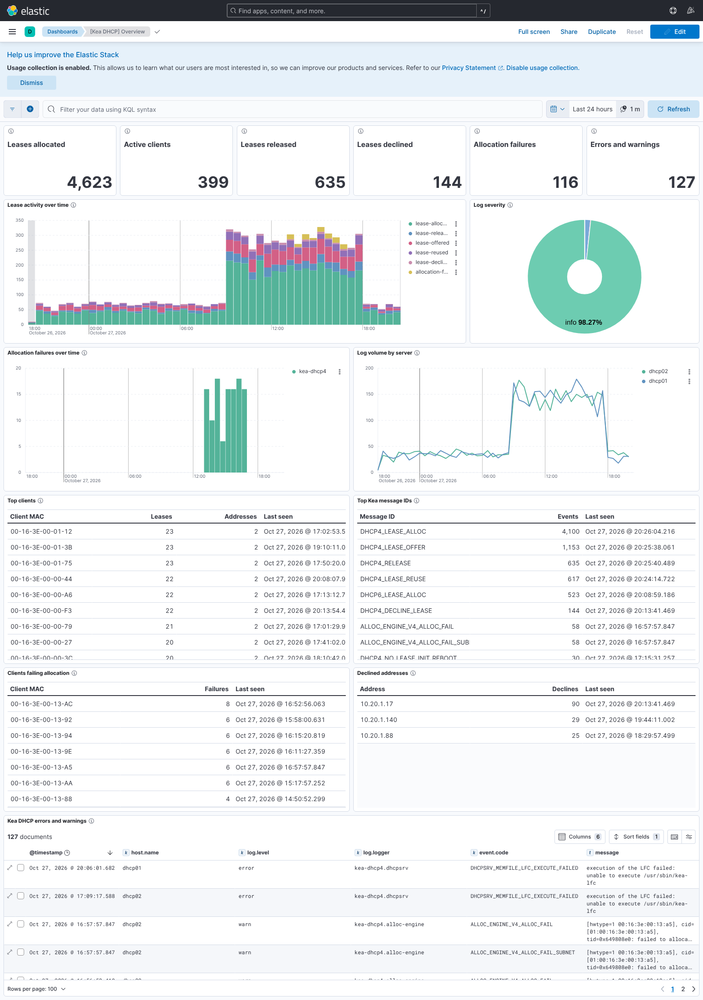

# elastic-kea_dhcp

Elasticsearch ingest pipeline and Kibana dashboard for [ISC Kea](https://www.isc.org/kea/) DHCP server logs.



## What's here

| Path | Purpose |
| --- | --- |
| `elasticsearch/ingest_pipeline/logs-kea.dhcp.yml` | Ingest pipeline source. Parses Kea log lines into ECS fields. |
| `elasticsearch/ingest_pipeline/logs-kea.dhcp.json` | The same pipeline as JSON, generated by `scripts/build.py`. |
| `elasticsearch/dev_tools/install-fleet.txt` | Paste-ready Kibana Dev Tools requests (pipeline + Fleet mappings), generated by `scripts/build.py`. |
| `docs/manual-install.md` | Step-by-step install from the Kibana UI with Fleet's Custom Logs integration. |
| `elasticsearch/index_template/` | `logs-kea.dhcp` data stream template and the `logs-kea.dhcp@package` mappings. |
| `kibana/kea-dhcp-dashboard.ndjson` | Data view, saved search, Lens panels and the **[Kea DHCP] Overview** dashboard. Generated by `scripts/build_dashboard.py`. |
| `filebeat/filebeat.yml` | Example Filebeat input for `/var/log/kea/`. |
| `scripts/install.sh` | Loads everything into Elasticsearch and Kibana. |
| `scripts/demo_data.py` | Generates a day of synthetic Kea logs to preview the dashboard. |
| `samples/`, `tests/` | Sample Kea logs, golden outputs and the pipeline test. |

Requires Elasticsearch and Kibana 8.12 or newer (tested on 8.15.3, 8.19.24 and 9.1.5).

## Log format

The pipeline expects Kea's **default** logger layout, which is what Kea writes when no `pattern` is set on a logger:

```
file/stdout:  %D{%Y-%m-%d %H:%M:%S.%q} %-5p [%c/%i.%t] %m
              2026-10-27 08:01:13.601 INFO  [kea-dhcp4.leases/1873.140226107447040] DHCP4_LEASE_ALLOC [hwtype=1 08:00:2b:02:3f:4e], cid=[01:08:00:2b:02:3f:4e], tid=0x3d18f5e4: lease 192.0.2.10 has been allocated for 4000 seconds

syslog:       %-5p [%c.%t] %m
              INFO  [kea-dhcp4.leases.140226107447040] DHCP4_LEASE_ALLOC ...
```

The older layout without a thread id (`[%c/%i]`) and syslog lines that still carry an RFC 3164 or RFC 3339 syslog header are also accepted. If you set a custom `pattern` in Kea's `loggers` configuration, the header grok in the pipeline must be changed to match.

Multi-line debug output (`DHCP4_QUERY_DATA`, `DHCP4_RESPONSE_DATA` and similar packet dumps) is kept as one event when the shipper joins continuation lines, as the Filebeat example does.

Kea writes timestamps in local time with no offset. Set `event.timezone` (Filebeat's `add_locale` processor does this) or the pipeline assumes UTC.

### Log files

Read every `/var/log/kea/kea-*.log*` file, as the Filebeat example and the [Fleet guide](docs/manual-install.md) do:

- `kea-dhcp4.log`, `kea-dhcp6.log` and `kea-dhcp-ddns.log`.
- `kea-ctrl-agent.log`, on Kea releases older than 2.7.2. From 2.7.2 the daemons serve the control API themselves, so API access, TLS and command messages appear in the daemon logs.
- The files of child loggers. A child logger given its own output, such as `kea-dhcp4.leases` sent to `kea-dhcp4-leases.log`, writes only to that file. Its events are not in `kea-dhcp4.log`.

Skip the empty `.lock` files Kea 3 keeps next to each log. Kea's forensic (legal) log files end in `.txt` and are not Kea log lines.

Kea servers set up with [ansible-role-kea_dhcp](https://github.com/jmaughmer/ansible-role-kea_dhcp) work as they are. It writes these files with the default layout unless you set `kea_log_pattern`, and its `kea_*_extra_loggers` create the child-logger files described above. The pipeline was checked against Kea 3.0.5 logs from that role's test scenarios:

- the API in the daemons, with and without TLS
- HA hot-standby and passive-backup over TLS
- MySQL lease and host databases
- the phpIPAM reservation sync
- configuration reloads

## Install

### Manual install with Kibana Dev Tools and Fleet (recommended)

Follow **[docs/manual-install.md](docs/manual-install.md)**. In short:

1. Paste [`elasticsearch/dev_tools/install-fleet.txt`](elasticsearch/dev_tools/install-fleet.txt) into **Dev Tools > Console** and run it. This creates the `logs-kea.dhcp` pipeline and the `logs-kea.dhcp@custom` mappings.
2. Add the **Custom Logs (Filestream)** integration to your Kea servers' agent policy with dataset `kea.dhcp` and `pipeline: logs-kea.dhcp`, plus the multiline parser and `add_locale` processor from the guide.
3. Import [`kibana/kea-dhcp-dashboard.ndjson`](kibana/kea-dhcp-dashboard.ndjson) in **Stack Management > Saved Objects**.

### Scripted install

```sh
export ES_URL=https://elasticsearch.example.com:9200
export KIBANA_URL=https://kibana.example.com:5601
export ES_API_KEY=...          # or ES_USER / ES_PASS
./scripts/install.sh
```

This creates:

- ingest pipeline `logs-kea.dhcp`
- component template `logs-kea.dhcp@package`
- index template `logs-kea.dhcp` (pattern `logs-kea.dhcp-*`, `index.default_pipeline: logs-kea.dhcp`)
- the Kibana data view, saved search, visualizations and dashboard (set `KIBANA_SPACE` for a non-default space, or `KIBANA_URL=""` to skip)

Site-specific processing can go in an optional `logs-kea.dhcp@custom` pipeline, and extra mappings in a `logs-kea.dhcp@custom` component template. Both are picked up automatically when present.

### Shipping with Filebeat

Use [`filebeat/filebeat.yml`](filebeat/filebeat.yml). It reads every `kea-*.log` file in `/var/log/kea/` (see [Log files](#log-files)), including Kea's own rotated `.1`, `.2` files. It joins multi-line events, adds `event.timezone`, and writes to the `logs-kea.dhcp-default` data stream.

### Shipping with Elastic Agent

See [docs/manual-install.md](docs/manual-install.md) for the Custom Logs integration settings. To script the Elasticsearch side instead of using Dev Tools, run `./scripts/install.sh --fleet`. It installs the same pipeline and `logs-kea.dhcp@custom` mappings as the Dev Tools file, and skips the index template that Fleet owns.

## Fields

Standard ECS fields are filled where they apply: `@timestamp`, `log.level`, `log.logger`, `process.name`/`pid`/`thread.id`, `service.name`/`version`, `event.code` (the Kea message ID), `event.action`, `event.category`, `event.type`, `event.outcome`, `event.reason`, `client.mac` (ECS form, `08-00-2B-02-3F-4E`), `client.ip`, `source.*`, `destination.*`, `observer.ingress/egress.interface.name`, `network.protocol`, `user.name` (the API user), `related.ip`, `related.user`.

`network.protocol` is `dhcp`, `dhcpv6` or `dns` for the activity of the DHCP and DDNS servers, and `http` for control API requests. Command, HA and hook-management messages have no network fields.

Kea-specific fields live under `kea.*`:

| Field | Example |
| --- | --- |
| `kea.client.hwaddr`, `kea.client.hwtype` | `08:00:2b:02:3f:4e`, `1` |
| `kea.client.id` (DHCPv4 client identifier), `kea.client.duid` (DHCPv6) | `01:08:00:2b:02:3f:4e` |
| `kea.transaction_id` | `0x3d18f5e4` |
| `kea.lease.address`, `kea.lease.type`, `kea.lease.duration`, `kea.lease.iaid`, `kea.lease.prefix_length` | `2001:db8:8:100::`, `prefix`, `7200`, `15`, `56` |
| `kea.subnet.id`, `kea.subnet.prefix`, `kea.shared_network.name` | `1`, `192.0.2.0/24` |
| `kea.allocation.attempts`, `kea.client.classes` | `254`, `["ALL","KNOWN"]` |
| `kea.dhcp.message_type`, `kea.dhcp.message_type_code` | `DHCPDISCOVER`, `1` |
| `kea.ha.state`, `kea.ha.previous_state`, `kea.ha.partner_state` | `READY` |
| `kea.ha.server_name`, `kea.ha.partner_name`, `kea.ha.partner_url` | `dhcp01`, `dhcp02`, `https://192.0.2.3:8001/` |
| `kea.command` | `config-get`, `reservation-add`, `ha-heartbeat` |
| `kea.logger.component` | `leases`, `alloc-engine`, `ha-hooks` |

`event.action` values:

| Area | Values |
| --- | --- |
| Leases | `lease-allocated`, `lease-reused`, `lease-offered`, `lease-released`, `lease-declined`, `lease-not-found`, `lease-reclaimed`, `init-reboot`, `allocation-failed` |
| Packets | `packet-received`, `packet-sent`, `packet-nak`, `packet-dropped`, `subnet-selection-failed` |
| Server | `server-started`, `server-stopped`, `config-applied`, `config-reload-requested`, `config-failed` |
| Control API | `command-received`, `api-auth-succeeded`, `api-auth-failed`, `tls-handshake-failed`, `api-command-rejected` |
| HA | `ha-state-changed`, `ha-service-started`, `ha-communication-interrupted`, `ha-heartbeat-failed`, `ha-lease-update-failed`, `ha-sync-completed`, `ha-sync-failed`, `ha-invalid-partner-state`, `ha-terminated` |

Message IDs without a mapping still get `event.code`, `event.category` and `event.type`.

Some actions need a note:

- **`lease-declined`** covers a client's DHCPDECLINE and the addresses Kea's ping check finds in use (`DHCP4_SERVER_INITIATED_DECLINE`). `event.reason` says which.
- **`config-reload-requested`** is a SIGHUP or `config-reload` command, for example `systemctl reload kea-dhcp4`. The reload either ends in `config-applied` or in `config-failed`, and a failed reload leaves the previous configuration running. `systemctl reload` reports success either way.
- **The API events** (`api-auth-failed`, `tls-handshake-failed`) are logged by Kea at INFO. Kea doesn't log the client's address with a failed password; a failed TLS handshake has it in `source.ip`.

Unparseable lines keep `event.original`, get `event.kind: pipeline_error` and the tag `kea_parse_failure`. Add the tag `preserve_original_event` at the shipper to keep `event.original` on every document.

Kea logs `DHCP4_RESERVATIONS_LOOKUP_FIRST_ENABLED`, `DHCP6_RESERVATIONS_LOOKUP_FIRST_ENABLED` and `DHCPSRV_MT_DISABLED_QUEUE_CONTROL` as warnings at every start and reload when multi-threading is on, which is the default. They need no action, so the pipeline tags them `kea_expected_warning`, and the dashboard leaves them out of its errors and warnings.

## Dashboard

**[Kea DHCP] Overview** (default range: last 24 hours) shows:

- **Tiles:** leases allocated, active clients (distinct MACs), releases, declines (client or ping check), allocation failures, errors and warnings
- **Lease activity over time** by action, and **log severity** share
- **Allocation failures over time** by service (kea-dhcp4 / kea-dhcp6), which usually means a full pool or a client class with no matching pool
- **Log volume by server**, useful for spotting one half of an HA pair going quiet
- **Top clients** with lease count, distinct addresses and last seen
- **Top Kea message IDs**, without HA heartbeats
- **Clients failing allocation** and **declined addresses** (with who found each one), which point at pool exhaustion and IP conflicts
- **HA state by server** (latest state and partner state) and **HA problems over time** (failed heartbeats, lease updates and syncs, lost contact, terminated HA)
- **API access failures** (wrong or missing credentials, TLS clients without a valid certificate), **API commands** received, and **configuration loads and reloads**, including failed ones
- **Errors and warnings** log table

Most lease panels work at Kea's default INFO severity. `kea.dhcp.message_type` and the packet fields only appear when the `kea-dhcp4.packets` / `kea-dhcp6.packets` loggers run at DEBUG.

To preview it with fake data:

```sh
ES_URL=http://localhost:9200 scripts/demo_data.py     # writes logs-kea.dhcp-demo
```

## Development

Tests run locally against throwaway Elasticsearch and Kibana containers in podman. On AlmaLinux 10 (including under WSL), install the prerequisites:

```sh
sudo dnf install -y podman python3 python3-pyyaml curl
```

Then run the whole suite:

```sh
scripts/test-local.sh                       # Elastic Stack 8.15.3
STACK_VERSION=9.1.5 scripts/test-local.sh   # another version
scripts/test-local.sh --keep                # leave Kibana up with demo data to look at the dashboard
```

`test-local.sh` checks that the generated files are current, starts Elasticsearch, runs every sample log through the pipeline and compares the output with `tests/expected/`, indexes the samples to catch mapping errors, sends the Dev Tools file's requests and indexes the samples the way the Fleet integration does, then starts Kibana, imports the dashboard, loads demo data and checks that every saved object is present. The containers are removed at the end unless you pass `--keep`. Set `ES_PORT` / `KIBANA_PORT` if 9200 or 5601 are taken.

After changing the sources, regenerate the derived files:

```sh
scripts/build.py                  # pipeline JSON and Dev Tools file from the YAML and mappings
scripts/build_dashboard.py        # dashboard NDJSON
ES_URL=http://localhost:9200 tests/test_pipeline.py --generate   # accept new pipeline output into tests/expected/
```
