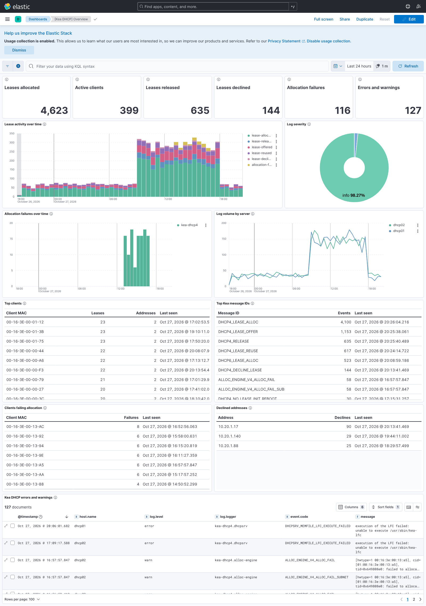

# elastic-kea_dhcp

Elasticsearch ingest pipeline and Kibana dashboard for [ISC Kea](https://www.isc.org/kea/) DHCP server logs.



## What's here

| Path | Purpose |
| --- | --- |
| `elasticsearch/ingest_pipeline/logs-kea.dhcp.yml` | Ingest pipeline source. Parses Kea log lines into ECS fields. |
| `elasticsearch/ingest_pipeline/logs-kea.dhcp.json` | The same pipeline as JSON, generated by `scripts/build.py`. Paste into Dev Tools if you prefer. |
| `elasticsearch/index_template/` | `logs-kea.dhcp` data stream template and the `logs-kea.dhcp@package` mappings. |
| `kibana/kea-dhcp-dashboard.ndjson` | Data view, saved search, Lens panels and the **[Kea DHCP] Overview** dashboard. Generated by `scripts/build_dashboard.py`. |
| `filebeat/filebeat.yml` | Example Filebeat input for `/var/log/kea/`. |
| `scripts/install.sh` | Loads everything into Elasticsearch and Kibana. |
| `scripts/demo_data.py` | Generates a day of synthetic Kea logs to preview the dashboard. |
| `samples/`, `tests/` | Sample Kea logs, golden outputs and the pipeline test. |

Requires Elasticsearch and Kibana 8.12 or newer (tested on 8.15.3 and 9.1.5).

## Log format

The pipeline expects Kea's **default** logger layout, which is what Kea writes when no `pattern` is set on a logger:

```
file/stdout:  %D{%Y-%m-%d %H:%M:%S.%q} %-5p [%c/%i.%t] %m
              2026-10-27 08:01:13.601 INFO  [kea-dhcp4.leases/1873.140226107447040] DHCP4_LEASE_ALLOC [hwtype=1 08:00:2b:02:3f:4e], cid=[01:08:00:2b:02:3f:4e], tid=0x3d18f5e4: lease 192.0.2.10 has been allocated for 4000 seconds

syslog:       %-5p [%c.%t] %m
              INFO  [kea-dhcp4.leases.140226107447040] DHCP4_LEASE_ALLOC ...
```

The older layout without a thread id (`[%c/%i]`) and syslog lines that still carry an RFC 3164 or RFC 3339 syslog header are also accepted. If you set a custom `pattern` in Kea's `loggers` configuration, the header grok in the pipeline must be changed to match.

Multi-line debug output (`DHCP4_QUERY_DATA`, `DHCP4_RESPONSE_DATA` and similar packet dumps) is kept as one event when the shipper joins continuation lines, as the Filebeat example does.

Kea writes timestamps in local time with no offset. Set `event.timezone` (Filebeat's `add_locale` processor does this) or the pipeline assumes UTC.

## Install

```sh
export ES_URL=https://elasticsearch.example.com:9200
export KIBANA_URL=https://kibana.example.com:5601
export ES_API_KEY=...          # or ES_USER / ES_PASS
./scripts/install.sh
```

This creates:

- ingest pipeline `logs-kea.dhcp`
- component template `logs-kea.dhcp@package`
- index template `logs-kea.dhcp` (pattern `logs-kea.dhcp-*`, `index.default_pipeline: logs-kea.dhcp`)
- the Kibana data view, saved search, visualizations and dashboard (set `KIBANA_SPACE` for a non-default space, or `KIBANA_URL=""` to skip)

Site-specific processing can go in an optional `logs-kea.dhcp@custom` pipeline, and extra mappings in a `logs-kea.dhcp@custom` component template. Both are picked up automatically when present.

### Shipping with Filebeat

Use [`filebeat/filebeat.yml`](filebeat/filebeat.yml). It reads the kea-dhcp4, kea-dhcp6, kea-dhcp-ddns and kea-ctrl-agent logs in `/var/log/kea/` (including Kea's own rotated `.1`, `.2` files), joins multi-line events, adds `event.timezone`, and writes to the `logs-kea.dhcp-default` data stream.

### Shipping with Elastic Agent

1. Add the **Custom Logs (Filestream)** integration with dataset name `kea.dhcp`, the same paths as the Filebeat example, and the same multiline parser and `add_locale` processor under *Advanced options*.
2. Set the integration's ingest pipeline to `logs-kea.dhcp`.
3. Run `./scripts/install.sh --fleet`. This installs the pipeline and puts the field mappings in `logs-kea.dhcp@custom`, which Fleet's own `logs-kea.dhcp` template includes, instead of installing a competing index template.

## Fields

Standard ECS fields are filled where they apply: `@timestamp`, `log.level`, `log.logger`, `process.name`/`pid`/`thread.id`, `service.name`/`version`, `event.code` (the Kea message ID), `event.action`, `event.category`, `event.type`, `event.outcome`, `client.mac` (ECS form, `08-00-2B-02-3F-4E`), `client.ip`, `source.*`, `destination.*`, `observer.ingress/egress.interface.name`, `network.protocol`, `related.ip`.

Kea-specific fields live under `kea.*`:

| Field | Example |
| --- | --- |
| `kea.client.hwaddr`, `kea.client.hwtype` | `08:00:2b:02:3f:4e`, `1` |
| `kea.client.id` (DHCPv4 client identifier), `kea.client.duid` (DHCPv6) | `01:08:00:2b:02:3f:4e` |
| `kea.transaction_id` | `0x3d18f5e4` |
| `kea.lease.address`, `kea.lease.type`, `kea.lease.duration`, `kea.lease.iaid`, `kea.lease.prefix_length` | `2001:db8:8:100::`, `prefix`, `7200`, `15`, `56` |
| `kea.subnet.id`, `kea.subnet.prefix`, `kea.shared_network.name` | `1`, `192.0.2.0/24` |
| `kea.allocation.attempts`, `kea.client.classes` | `254`, `["ALL","KNOWN"]` |
| `kea.dhcp.message_type`, `kea.dhcp.message_type_code` | `DHCPDISCOVER`, `1` |
| `kea.ha.state`, `kea.ha.previous_state`, `kea.ha.partner_state` | `READY` |
| `kea.logger.component` | `leases`, `alloc-engine`, `ha-hooks` |

`event.action` values: `lease-allocated`, `lease-reused`, `lease-offered`, `lease-released`, `lease-declined`, `lease-not-found`, `lease-reclaimed`, `init-reboot`, `allocation-failed`, `packet-received`, `packet-sent`, `packet-nak`, `packet-dropped`, `subnet-selection-failed`, `server-started`, `server-stopped`, `config-applied`, `config-failed`, `ha-state-changed`. Message IDs without a mapping still get `event.code`, `event.category` and `event.type`.

Unparseable lines keep `event.original`, get `event.kind: pipeline_error` and the tag `kea_parse_failure`. Add the tag `preserve_original_event` at the shipper to keep `event.original` on every document.

## Dashboard

**[Kea DHCP] Overview** (default range: last 24 hours) shows:

- **Tiles:** leases allocated, active clients (distinct MACs), releases, declines, allocation failures, errors and warnings
- **Lease activity over time** by action, and **log severity** share
- **Allocation failures over time** by service (kea-dhcp4 / kea-dhcp6), which usually means a full pool or a client class with no matching pool
- **Log volume by server**, useful for spotting one half of an HA pair going quiet
- **Top clients** with lease count, distinct addresses and last seen
- **Top Kea message IDs**
- **Clients failing allocation** and **declined addresses**, which point at pool exhaustion and IP conflicts
- **Errors and warnings** log table

Most lease panels work at Kea's default INFO severity. `kea.dhcp.message_type` and the packet fields only appear when the `kea-dhcp4.packets` / `kea-dhcp6.packets` loggers run at DEBUG.

To preview it with fake data:

```sh
ES_URL=http://localhost:9200 scripts/demo_data.py     # writes logs-kea.dhcp-demo
```

## Development

Tests run locally against throwaway Elasticsearch and Kibana containers in podman. On AlmaLinux 10 (including under WSL), install the prerequisites:

```sh
sudo dnf install -y podman python3 python3-pyyaml curl
```

Rootless podman is fine. The containers only publish ports 9200 and 5601.

Then run the whole suite:

```sh
scripts/test-local.sh                       # Elastic Stack 8.15.3
STACK_VERSION=9.1.5 scripts/test-local.sh   # another version
scripts/test-local.sh --keep                # leave Kibana up with demo data to look at the dashboard
```

`test-local.sh` checks that the generated files are current, starts Elasticsearch, runs every sample log through the pipeline and compares the output with `tests/expected/`, indexes the samples to catch mapping errors, then starts Kibana, imports the dashboard, loads demo data and checks that every saved object is present. The containers are removed at the end unless you pass `--keep`. Set `ES_PORT` / `KIBANA_PORT` if 9200 or 5601 are taken.

After changing the sources, regenerate the derived files:

```sh
scripts/build.py                  # pipeline JSON from the YAML
scripts/build_dashboard.py        # dashboard NDJSON
ES_URL=http://localhost:9200 tests/test_pipeline.py --generate   # accept new pipeline output into tests/expected/
```
